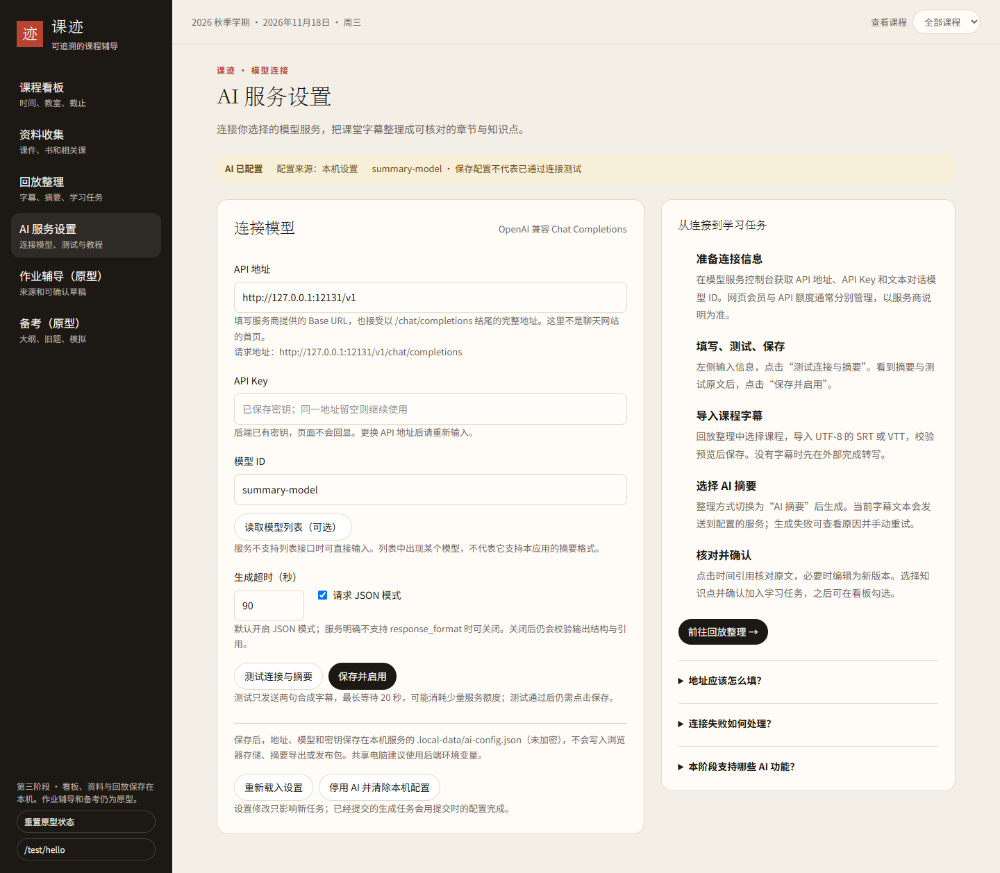

# 课迹 AI 配置与完整使用教程

适用版本：第三阶段本机版，2026-11-18。支持 OpenAI 兼容的 Chat Completions 文本模型。无需安装模型 SDK，Python 3.10+ 即可运行后端；本地原文摘录不需要网络或密钥。

## 1. 启动软件

1. 解压 `课迹第三阶段可运行版.zip`，进入 `keji-stage3` 文件夹。已有源码目录的用户直接使用该目录。
2. Windows 双击 `start-keji.cmd`。需要 Python 3.10+；启动器也会查找本机 Codex 随附解释器。没有可用解释器时先安装 Python，或设置 `KEJI_PYTHON` 为解释器完整路径。
3. 打开 <http://127.0.0.1:8765>，点击侧栏“AI 服务设置”，也可直接打开 <http://127.0.0.1:8765/settings/ai>。
4. 发布包包含已构建网页；源码若修改过前端，先运行 `npm ci`、`npm run build`。开发环境需要 Node 22.12+。

也可在项目目录运行 `python server/app.py`，前台运行时用 Ctrl+C 停止。Windows 后台启动日志在 `.runtime/server.log` 与 `.runtime/server-error.log`，PID 在 `.runtime/server.pid`。服务仅监听本机，不要将它作为公网多人服务部署。

## 2. 准备三项连接信息

在所选服务商的 API 控制台获取以下信息。只在本机软件输入真实密钥，不要写入教程、Git、聊天记录或截图。

原开发计划优先使用课程提供的 AiWork 平台。若该账号提供 OpenAI 兼容 API，直接填写课程方给出的地址、密钥与模型 ID 即可；若只提供网页交互，需向课程方获取可调用的 API 信息。下面的厂商地址只是配置示例，不要求另外购买服务；尚无 API 时继续使用本地摘录。

|信息|填写方法|
|---|---|
|API 地址|服务商给出的 Base URL，例如 `https://api.deepseek.com`；也可直接粘贴 `https://api.deepseek.com/chat/completions`|
|API Key|由同一服务签发、具备调用权限的密钥；本机无认证服务可留空|
|模型 ID|服务端接受的准确名称，需为支持文本对话的模型；从控制台复制，或使用“读取模型列表”|

聊天网站首页、普通网页登录链接、文件下载地址都不是模型 API 地址。不要把 `/responses`、`/messages`、Gemini 原生接口填作 Base URL；本软件当前只实现 Chat Completions 协议。模型 ID 不应凭产品展示名称猜测。

可参考的地址形式：

|服务|地址形式|注意|
|---|---|---|
|DeepSeek|`https://api.deepseek.com`|模型名称以当前账号和官方文档为准；[官方接入说明](https://api-docs.deepseek.com/)|
|阿里云百炼|控制台提供的 `https://{WorkspaceId}.cn-beijing.maas.aliyuncs.com/compatible-mode/v1` 等地址|将 `{WorkspaceId}` 替换为自己的业务空间 ID；地域与密钥必须匹配；[官方兼容接口说明](https://help.aliyun.com/zh/model-studio/compatibility-of-openai-with-dashscope)|
|本机兼容模型服务|例如 `http://127.0.0.1:1234/v1`|端口以实际运行服务为准，需要先启动模型服务；不能填课迹自身的 8765 端口|
|其他兼容供应商|控制台提供的 HTTPS Base URL|必须支持 `POST /chat/completions` 和 `choices[0].message.content` 返回格式|

地址示例核对于 2026-11-18，服务商可能更新模型、地域或域名，使用时以其官方控制台为准。本软件不会自动申请账号、购买额度或下载模型。

## 3. 在软件内配置、测试和保存

1. 填写“API 地址”。页面会显示最终请求地址，完整 `/chat/completions` 地址会自动规范化，不会重复追加路径。
2. 填写“API Key”。输入框以密码方式显示。远程服务要求密钥；HTTP 仅允许本机地址，远程 API 需 HTTPS。
3. 可以点击“读取模型列表（可选）”。该操作请求同一 Base URL 的 `/models`，不会保存设置。若服务不提供这个接口，直接输入模型 ID 即可。
4. 填写“模型 ID”。默认“生成超时”为 90 秒，可设置为 5–90 的整数；超过时限会明确报错，保留旧摘要。
5. 默认勾选“请求 JSON 模式”。这会发送 `response_format: {"type":"json_object"}`。若服务明确报告不支持此字段，可取消后重测；无论是否开启，输出都必须符合摘要结构和引用要求。DeepSeek 的 JSON 模式要求可见[官方说明](https://api-docs.deepseek.com/guides/json_mode/)。
6. 点击“测试连接与摘要”。测试只发送两句内置合成字幕，不发送已导入课程；最多等待 20 秒，可能产生少量 API 费用。它会检查实际生成、JSON 结构和有效字幕引用，不只是检查网址能否打开。
7. 看到“连接测试通过”后，核对显示的测试摘要及原文，再点击“保存并启用”。**测试不会自动保存；保存本身也不会自动发起模型请求。** 可以先保存暂时不可连接的服务，稍后再测试。
8. 页面显示“AI 已配置”，配置立即用于新任务，无需重启服务。回放页仍默认选本地摘录，需要主动切换“AI 摘要”。



截图使用本机模拟服务和虚构模型 ID，仅展示操作界面，不代表真实厂商联调通过。

## 4. 从字幕生成可追溯摘要

1. 点击“前往回放整理”。选择已有课程，或填写新课程编号和名称。
2. 选择 UTF-8 编码的 `.srt` 或 `.vtt` 文件，也可粘贴字幕正文。每份不超过 5 MiB、10000 段，每段不超过 10000 字。时间需递增、结束晚于开始，且在 24 小时内。
3. 填写回放标题，可选填原始回放链接和总时长。仅有音视频而没有字幕时，需要先在外部完成转写；本阶段不能直接处理 MP4/MP3。
4. 点击“校验并预览字幕”，核对课程、段数、时间和原文，再点击“确认导入字幕”。同课程同内容重复导入不会新增回放。
5. 在“整理方式”选择“AI 摘要”，点击“生成摘要”。**该操作会把当前回放的字幕 ID 和文本发送至你配置的模型服务。** 不会发送教学网 Cookie、API 配置文件、其他课程资料或学生完成状态。
6. 等待“整理完成”。任务在后端执行，可切换到其他页面；同一讲正在处理时不会重复提交。模型失败会显示原因，可手动重试；不会自动重试计费调用或用本地结果冒充 AI。
7. 查看“章节与知识点”，点击引用时间定位原始字幕。模型返回的时间或引用正文不会直接被采信，后端根据真实字幕 ID 重新填充。
8. 语义仍需人工核对。必要时点击“编辑摘要”，修改并“保存为新版本”；旧版本保留，可通过“摘要版本”切换查看。“导出摘要与引用”会下载 JSON，包含版本及原文依据，不包含 API Key。
9. 选中需要学习的知识点，点击“确认加入学习任务”。生成摘要本身不创建学习任务。每讲最多创建一条任务，保留确认时版本快照，重复点击不会新增。
10. 返回课程看板，查看学习任务并勾选完成；刷新后完成状态仍保留。任务链接可回到当时确认的摘要版本。

没有课程字幕时，可先点击“填入合成示例”完成演示。只有点击校验和确认导入后才会保存。要离线使用，选择“本地原文摘录”，它选取实际字幕原句，不提供模型语义归纳。

## 5. 更换模型、停用和配置保存

- **同地址更换模型/超时/JSON 模式：**输入框中 API Key 留空会保留后端已有密钥；测试后保存。
- **更换 API 地址：**需重新输入该地址的密钥，系统不会把之前服务的密钥自动发往新地址。无认证本机服务例外，可留空。
- **停用：**点击“停用 AI 并清除本机配置”。本机保存的密钥被清除，并记录停用状态；环境变量不会意外重新启用 AI。旧摘要、课程、学习任务均保留。
- **已提交任务：**继续使用提交时捕获的配置完成；更换或停用只影响后续新任务，不会撤回已发出的请求。
- **多个页面同时修改：**过期页面会提示重新载入，避免覆盖另一页面刚保存的配置。
- **本机存储：**默认在 `.local-data/ai-config.json` 中保存，密钥未加密，不存入浏览器 localStorage/sessionStorage。该目录被 Git 忽略，也不打入可运行 ZIP；不要分享该文件。
- **自定义数据库：**使用 `--db` 时，配置文件位于该数据库同目录，名称仍为 `ai-config.json`。

## 6. 沿用后端环境变量（可选）

已有部署也可以继续使用 `KEJI_AI_BASE_URL`、`KEJI_AI_API_KEY`、`KEJI_AI_MODEL`，三个变量必须在**启动后端的进程环境**内配置齐全。`.env.example` 是说明文件，不会被程序自动读取；变量不要使用 `VITE_` 前缀。

PowerShell 示例（密钥从密码输入框读取，不写进命令历史）：

```powershell
$env:KEJI_AI_BASE_URL = 'https://api.example.com/v1'
$env:KEJI_AI_MODEL = 'your-model-id'
$aiSecret = Read-Host '请输入 API Key' -AsSecureString
$env:KEJI_AI_API_KEY = [System.Net.NetworkCredential]::new('', $aiSecret).Password
python server/app.py
```

先停止已运行的课迹进程，再用这个终端启动。环境变量来源默认 90 秒、JSON 模式开启。页面保存的本机配置优先；若三个环境变量已配置，页面可点击“改用后端环境变量”，删除本机覆盖并立即使用当前后端进程继承的值。操作系统环境变量后来改变时，仍需重启后端才能读取新值。

停止前台服务后，可用 `Remove-Item Env:KEJI_AI_API_KEY` 清理当前终端变量。共享电脑上应使用受管理的后端环境与个人系统账号，不共享保存了密钥的项目目录。

## 7. 常见问题

|现象|处理方法|
|---|---|
|页面无法连接本地服务|运行启动器；检查 8765 是否占用及 `.runtime/server-error.log`；刷新页面|
|保存后看不到 AI 摘要|先回到回放页，确保设置显示“AI 已配置”；在整理方式中主动选择 AI；旧浏览器页面可刷新|
|HTTP 401|核对密钥是否正确/过期、是否属于该 API 地址及地域；重新输入并测试|
|HTTP 403|检查模型权限、服务开通和地域限制|
|HTTP 404|检查 Base URL 路径与模型 ID；不要重复写 `/chat/completions`；只有 `/models` 失败时可以手动填写模型|
|HTTP 400|查看官方接口要求；确认模型支持文本对话；不支持 `response_format` 时关闭 JSON 模式重测|
|HTTP 429|检查余额、额度或服务限流，稍后手动重试；系统不会自动反复调用|
|超时或连接失败|检查运行 Python 后端这台机器的网络、代理和服务状态；测试上限 20 秒，实际生成上限由设置决定（最多 90 秒）|
|模型未返回 JSON 摘要|选择支持结构化中文文本输出的模型，优先启用 JSON 模式；空白/截断/非 JSON 输出不保存|
|提示引用不存在|模型编造了字幕 ID，本次结果被拒绝；换模型或重试，旧版本仍在|
|字幕超过模型输入上限|单次序列化输入上限 60000 字符；拆分课次或使用本地摘录。服务商模型还可能有更小的上下文限制|
|页面提示配置已变化|点击“重新载入设置”，重新检查信息后操作|
|停用后仍收到任务结果|之前已提交的任务会继续使用原配置完成；停用阻止新 AI 任务|

## 8. 数据备份与本阶段范围

在项目目录运行 `python tools/backup.py`，通过 SQLite 备份接口保存课程、字幕、摘要版本及学习状态。恢复时先停止服务并保留原库，再将备份恢复到数据库路径。该工具**不备份 AI 配置文件或密钥**，换电脑后需重新配置。不要把 `.local-data`、`.runtime` 或真实课程资料添加到 Git。

当前 AI 能力为字幕章节与知识点摘要。作业辅导、备考仍是原型，自动音视频转写、OCR、文件全文解析、联网检索和多人身份系统尚未实现。模型引用可定位不等于概括必然正确，确认学习任务前仍需核对原文。

本次代码通过本机模拟服务测试，没有替用户调用真实收费模型。真实使用前用自己的服务进行连接测试，并用一小段有权使用的字幕验收摘要质量。
