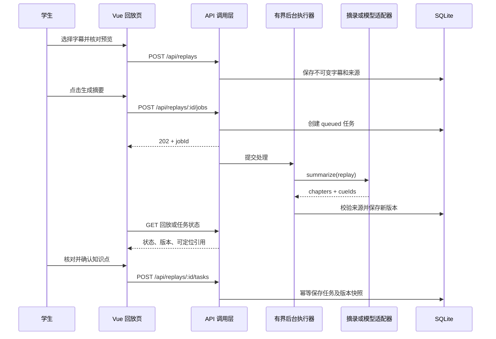

# 第三阶段接口与架构

前端沿用 Vue 3；Python 标准库 HTTP 服务负责本机边界与 JSON 校验；SQLite 保存课程、不可变字幕、摘要版本、生成任务和学习任务。调用层通过统一 `summarize(replay)` 接口使用本地摘录或后端模型服务。原架构中的通用 CLI 智能体没有启动，本次采用受控适配器；确认仍在网页端完成。

## 接口

所有写接口要求 JSON、合法本机 Host 与 Origin（命令行客户端无 Origin 时仍允许本机操作）；教学网扩展原接口额外需要临时连接码。AI 配置从本机设置页面提交到后端，前端不直接请求模型服务，也不持久化密钥。

|方法|路径|请求与结果|
|---|---|---|
|GET|`/api/capabilities`|可用摘要方式、字幕格式、大小限制；不返回密钥|
|GET|`/api/settings/ai`|启用状态、来源、地址、模型、超时、JSON 模式、`hasApiKey`、`revision`；不返回密钥|
|POST|`/api/settings/ai`|保存配置或 `action: "disable" / "environment"`；必须带最新 `revision`，过期返回 409|
|POST|`/api/settings/ai/test`|测试表单配置，用合成字幕验证模型生成与引用；不保存；最多 20 秒|
|POST|`/api/settings/ai/models`|请求配置地址下的 `/models`；可不填模型；不保存|
|POST|`/api/courses`|`{id,name}`；同名同 ID 幂等；已有 ID 不允许在此改名|
|POST|`/api/replays/preview`|字幕导入对象；只校验，返回段数、覆盖时长、前五段，不落库|
|POST|`/api/replays`|同一对象；返回 `{id,duplicate,cueCount}`；新建 201，重复 200|
|GET|`/api/replays`|简要回放清单，不包含字幕正文|
|GET|`/api/replays/:id`|字幕、最新摘要、版本元数据、最后任务与已确认任务 ID|
|POST|`/api/replays/:id/jobs`|`{provider:"local"或"ai"}`；202 返回任务；执行中的同一目标复用|
|GET|`/api/jobs/:id`|`queued/running/succeeded/failed`、错误码、结果版本|
|GET|`/api/replays/:id/versions/:version`|历史摘要及当时的引用|
|PATCH|`/api/replays/:id/summary`|`{baseVersion,chapters}`；新建人工编辑版本，旧版本冲突返回 409|
|POST|`/api/replays/:id/tasks`|`{confirmed:true,version,chapterIds:["p1"]}`；每讲最多一条，重复返回同一任务|
|PATCH|`/api/tasks/:id`|`{done:true或false}`；保存独立完成状态|
|GET|`/api/catalog`|原课程资料、课表、截止，加 `replays` 与 `tasks`|

导入对象：`courseId`、`title`、`filename`、`content` 必填；`sourceUrl`、`durationSeconds` 可选。必须先有课程。字幕限 UTF-8、5 MiB、10000 段、单段 10000 字、时间递增且在 24 小时内；给出媒体总时长时，所有字幕必须位于该时长内。不填总时长时显示“字幕覆盖到”，不冒称真实视频时长。

模型返回仅要求 `chapters:[{title,summary,cueIds}]`，1–12 章，每章 1–20 个有效字幕 ID。服务端忽略模型给出的时间与引用原文，重新从本讲字幕解析。未知来源会导致本次任务失败；旧版本不变。该校验保证引用定位有效，不能自动证明模型概括的语义真实性。

### AI 配置对象与生效规则

保存/测试请求：`{revision, baseUrl, model, apiKey, timeout:90, jsonMode:true}`。`revision` 来自设置 GET；保存操作默认 `action:"save"`。同一规范化 Base URL 的空密钥保留旧值，更换地址时必须重新输入，免认证的本机地址可为空。URL 不能含凭证、查询参数或片段；远程必须 HTTPS，本机允许 HTTP。模型 ID 不得含空白；超时必须为 5–90 秒整数。

本机配置以原子替换方式写入数据库同目录的 `ai-config.json`；写入失败保留旧配置。页面优先于 `KEJI_AI_*` 环境变量；停用写入不含密钥的停用标记，以免环境变量意外重新启用。`action:"environment"` 删除本机覆盖，读取当前后端进程中的环境变量。无效配置不会阻止本地摘要服务启动。

运行时切换受锁保护，每个生成任务在提交时捕获摘要适配器；排队中任务继续使用原配置，新任务使用新配置。测试与模型查询共用最多两个并行名额，不自动重试；模型 HTTP/网络错误返回脱敏 502，结构错误返回 400，测试名额用尽返回 429。测试使用真实适配器与来源校验器，但输入仅为内置合成字幕。

## 事务与状态

字幕 ID 根据课程 ID 和规范化字幕内容计算；同一内容换文件名仍是同一回放，跨课程不会合并。原始字幕记录不被重新生成覆盖。

`replay_versions` 使用 `(replay_id, version)` 主键。每次生成和编辑都追加版本；人工编辑使用 `baseVersion` 乐观锁。`learning_tasks` 对回放 ID 建唯一约束，并保存确认时的章节及引用快照。重新生成、失败重试、重复导入不会改动任务或完成状态。

`replay_jobs` 持久化状态，数据库部分唯一索引防止同一回放出现两个活动任务。默认五个工作线程、总容量二十五；超限返回 429。启动恢复将未结束的旧任务标记为 `INTERRUPTED`，不自动调用付费模型，用户可手动重试。模型请求总超时 90 秒，输出最多 512 KiB，无自动网络重试或重定向；失败不会切换成本地结果。

所有 SQLite 连接显式关闭。旧版本数据库通过 `CREATE TABLE IF NOT EXISTS` 增加表，不删除或改写阶段二资料。备份使用 SQLite Backup API，恢复测试验证课程、摘要版本、任务与完成状态一致。

## 参考依据

- [OpenAI Chat API 官方参考](https://developers.openai.com/api/reference/resources/chat)：兼容消息及 JSON 输出接口。
- [MDN WebVTT 格式](https://developer.mozilla.org/en-US/docs/Web/API/WebVTT_API/Web_Video_Text_Tracks_Format)：时间行、标识、NOTE 与样式块。

本次没有复用 AutoPku 或其他第三方回放代码；SRT/VTT 解析、本地摘录和适配器为项目内实现，不把外部项目调研写成已集成转写服务。
