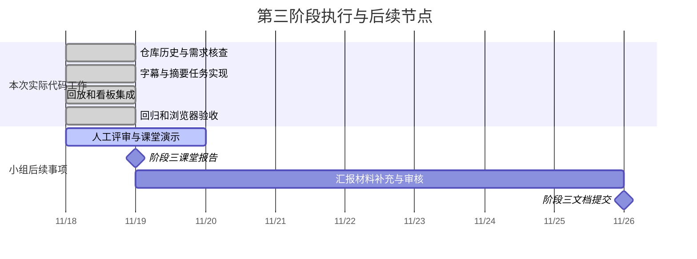

# 第三阶段进度与任务看板

状态日期为 2026-11-18。课程说明规定第三阶段为第一次迭代，11 月 19 日课堂报告、11 月 26 日提交阶段材料；项目原计划安排本阶段打通看板、收集和回放。以下“完成”表示本次可核实的软件实现，不代表课堂报告、人工评审或课程提交已发生。

## 原计划与执行

|原计划条目|原计划时间|本次执行状态|证据|
|---|---|---|---|
|已有回放处理技能调研|11.13–11.14|核对字幕规范与模型协议，选择项目内可测试适配器；不集成通用 CLI|`api.md`、`server/summarizers.py`|
|回放转写、摘要、时间点、学习任务|11.13–11.18|字幕导入、本地摘录、来源定位、任务确认已实现；音视频自动转写延后|`server/subtitles.py`、`server/replays.py`、浏览器验收|
|POST 调用层与回放页|11.13–11.19|异步 POST、状态 GET、失败重试、版本和看板衔接已实现|`server/app.py`、`ReplayView.vue`|
|真实模型接入|第二阶段汇报明确留待后续|软件内 API 地址/模型/密钥设置、模型查询、连接测试已实现；真实服务商联调待用户配置|`AISettingsView.vue`、`ai_settings.py`、`AI使用教程.md`|
|阶段三软件演示|11.19|已准备 10 页主讲、2 页补充的汇报稿和独立演示启动入口；课堂报告待组内进行|`presentation-demo.md`、`demo.md`|
|阶段三进度与 AI 开发过程材料|11.24–11.26|本目录已提供初稿，待组内评审补充|本文件、`ai-development.md`|

新增核查依据为《课迹_第二阶段汇报.pptx》。整体设计连续；自动转写延期、通用 CLI 改为受控 API 适配器两项差异需在汇报中明确说明。逐页对照见 [阶段衔接核查](stage2-alignment.md)。

## Backlog

估算为相对复杂度点数，供组内排期参考，不代表成员实际工时。

|编号|优先级|任务|估算|状态|验收条件|
|---|---|---|---:|---|---|
|S3-01|P0|修复阶段二评审问题|3|完成|开放时间不成截止、详情保留、Windows 测试通过|
|S3-02|P0|字幕解析与预览导入|5|完成|SRT/VTT、UTF-8、大小时间边界、重复导入正确|
|S3-03|P0|可定位本地摘录|3|完成|原文生成、整讲分段、引用能回到字幕|
|S3-04|P0|异步任务与恢复|5|完成|排队/执行/成功/失败、并发上限、队满、重启失败状态|
|S3-05|P0|版本、编辑与导出|3|完成|重新生成与人工编辑不覆盖，过期编辑返回冲突|
|S3-06|P0|任务确认与看板|3|完成|无确认不创建、每讲去重、完成状态刷新保留|
|S3-07|P1|可配置模型适配器|3|代码完成，外部待验|本机协议、429、超时、错误 JSON 已测；待真实模型|
|S3-08|P1|Windows 启动与打包|2|完成|独立目录启动、预构建前端、运行指南|
|S3-09|P1|备份与恢复验证|2|完成|课程、摘要版本、任务与状态可恢复|
|S3-10|P1|团队人工评审与真实字幕抽检|3|待办|成员按来源逐项核对并记录实际判断|
|S3-11|P1|课堂 PPT 与汇报|3|稿件与演示指南已准备，课堂报告待进行|8 分钟内小组演示；实际成员分工、课堂报告和课程提交由组内完成|
|S4-01|P1|音视频转写适配|8|后续|真实转写服务、异步状态、字幕时间质量|
|S4-02|P1|作业辅导与通知确认|8|后续|原文、提取字段、用户确认、测试|
|S5-01|P1|备考大纲与练习生成|8|后续|材料范围、生成题标识、作答与解析|

## Kanban 快照

|待办|待外部联调或人工评审|已完成|
|---|---|---|
|课堂汇报与网盘提交|真实模型摘要及语义质量|阶段二三项评审修复、汇报稿与演示指南|
|音视频自动转写|真实字幕抽检、成员审阅|字幕导入、来源定位、本地摘录|
|作业辅导、备考生成|远端 CI（实际提交后）|任务队列、版本、确认与看板|
|公网身份与部署能力|课程服务器性能复核|自动化验证、启动包、备份恢复|

这是本地任务看板，未创建或修改 GitHub Projects。仓库分支、未提交改动和 PR 现状应由组员在课堂中据实展示。
