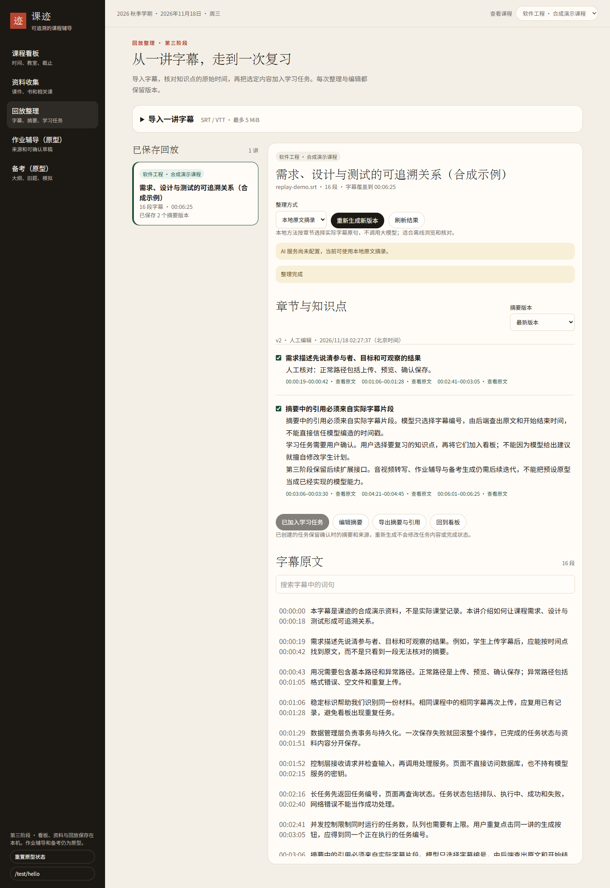
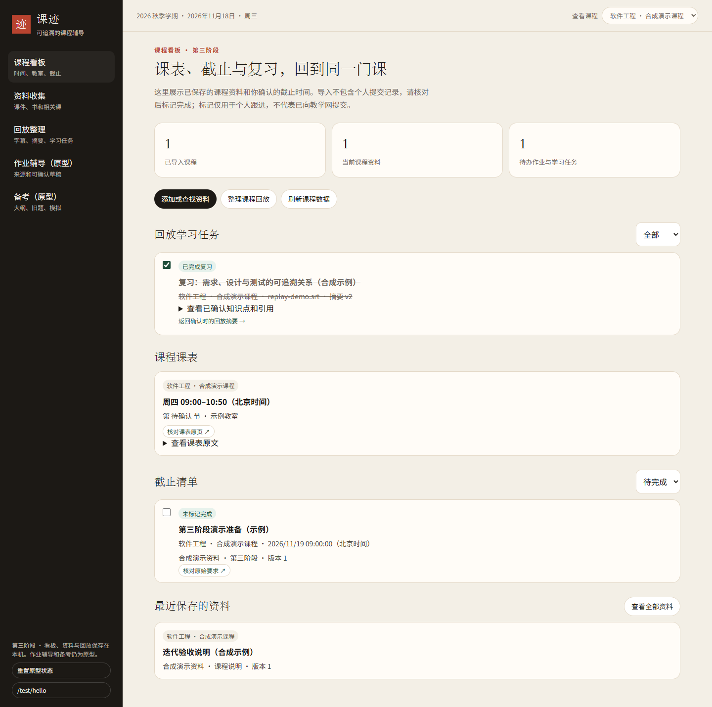
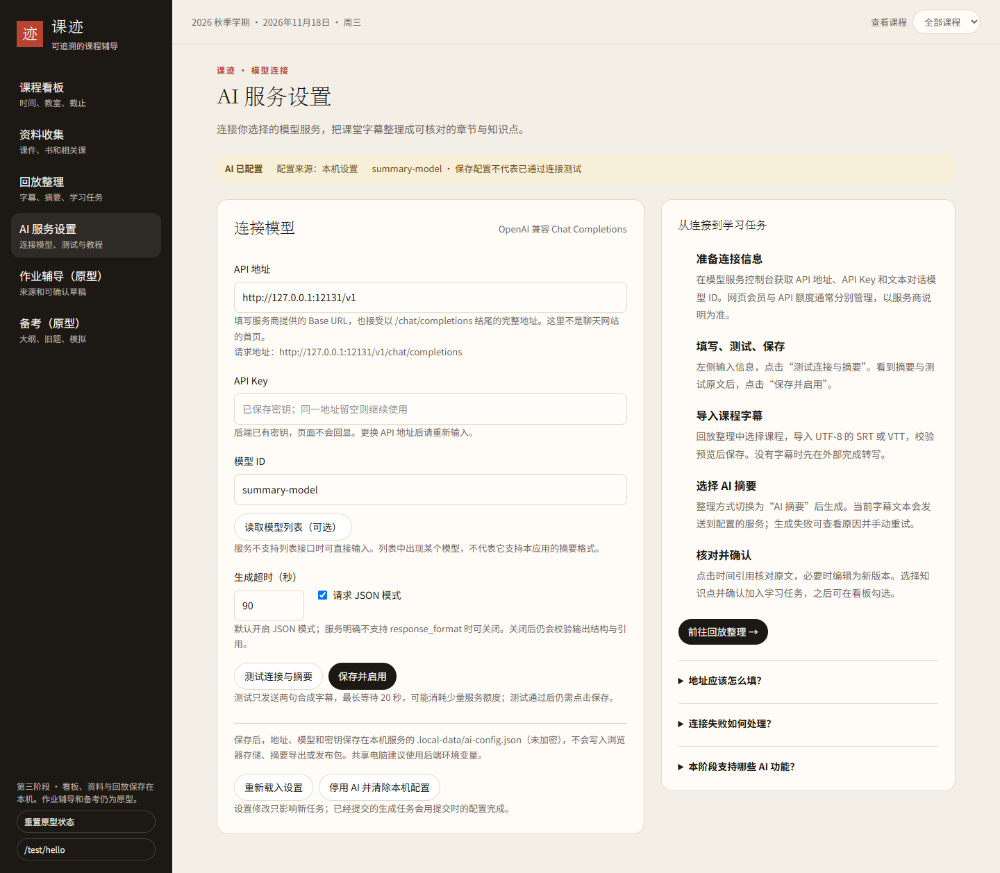

# 第三阶段软件验证报告

验证日期：2026-11-18。环境：Windows、Node 24.22.3、Python 3.12.14、本机单用户数据库；浏览器为 Edge 157.0.4341.60，Playwright 1.62.1。所有公开输入为合成示例，无真实课程原文、密钥或认证信息。

|验证项|结果|覆盖范围|
|---|---|---|
|Python 单元与接口测试|55 项通过|阶段二仓储、API、字幕边界、摘要引用、版本、任务、队列、恢复、备份、模型协议及配置生命周期|
|JavaScript DOM 回归|11 项通过|教学网解析、开放/截止区分、详情正文、课表及采集边界|
|生产前端构建|通过|Vite 6.4.3，Vue 页面与样式编译|
|浏览器端到端验收|18 项检查通过，0 个页面异常|原有 10 项流程，以及 8 项 AI 配置/模型列表/连接测试/生成/失败/停用/教程流程|
|界面检查|通过|1440px、1280×720 桌面与 768px 窄屏；无横向溢出；已查看完整截图|
|10 个处理任务并发|通过|默认最多 5 个执行，其余排队；队列容量拒绝另外覆盖|
|备份恢复|通过|课程资料、摘要版本、任务快照与完成状态一致；拒绝覆盖已有备份|
|基础只读性能|100 次请求，P95 13.59 ms|本机串行 `/api/catalog`，1 门课、1 份字幕，P50 1.61 ms，最大 21.75 ms|
|打包独立运行|通过|ZIP 完整性、敏感文件排除、独立 HTTP 服务、页面与资源、示例导入及确认任务均通过|

## 重要测试场景

正常字幕包括 SRT 的 UTF-8 BOM、CRLF、多行与毫秒，以及 VTT 的标识、NOTE、样式块和时间行设置。异常包括空文件、格式不支持、时间无效或逆序、过大输入、总时长冲突及危险来源地址。

仓储验证相同内容换文件名仍去重、不同课程分离、同一讲任务唯一、未确认不落任务、人工编辑冲突返回 409、重启后状态持久化。被中断的处理记录失败状态，旧摘要和完成状态保留。

模型适配器连接本地模拟 HTTP 服务，验证消息、JSON 输出、429、非 JSON、超时和输入长度限制；未知引用拒绝保存；异常不泄漏服务端错误正文或密钥。这不是外部模型联调或质量评分。

AI 设置另验证完整地址规范化、同地址空密钥保留、换地址不转发旧密钥、拒绝重定向、环境配置兼容、本机覆盖/停用/恢复、损坏配置恢复、过期页面冲突、原子写入失败、状态不回传密钥，以及排队任务固定提交时配置。浏览器实际通过本机模拟模型完成“填表→读取模型→连接测试→保存→AI 回放摘要→失败保留旧版本→停用”。测试仅使用合成字幕和虚构密钥，连接测试不创建课程或学习任务。

浏览器实际执行了从空库到课表、资料和回放的流程；下载 JSON 包含实际引用；看板任务刷新后仍完成；历史版本链接返回确认时版本；`/test/hello` 支持直接访问与刷新。

## 可复现命令

```sh
npm test
npm run build
npx playwright install chromium
npm run test:e2e
python tools/package_release.py
```

Windows 有 Edge 时可设置 `KEJI_BROWSER_CHANNEL=msedge`，无需另装 Chromium。可用 `KEJI_PYTHON` 指定解释器。原始测试输出、性能 JSON 和截图存于被 Git 忽略的 `test-results/`；独立测试数据库位于 `.runtime/`。

性能结果仅说明当前本机小数据集，不证明需求书中 20 个并发用户、10 门课程及大量资料的目标。真实模型质量、Chrome/Firefox 兼容、课程服务器性能及远端 CI 本次未验收。实际教学网登录采集没有在本次重新操作，只运行采集器回归测试。

## 合成数据界面截图






